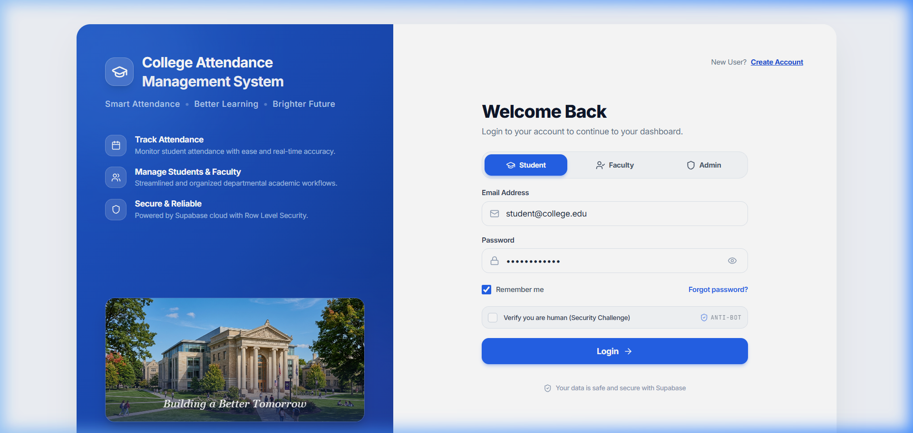
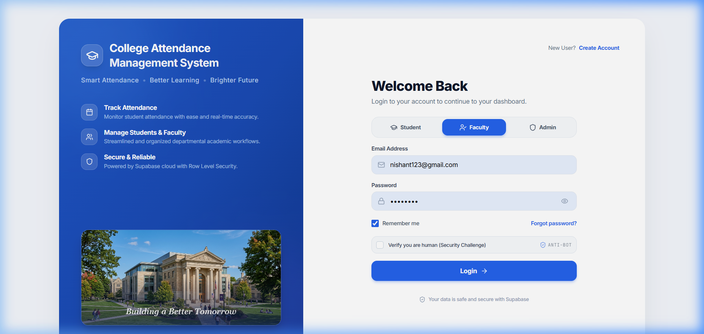
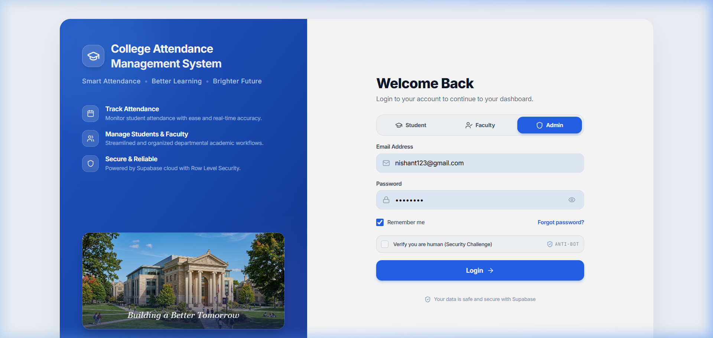
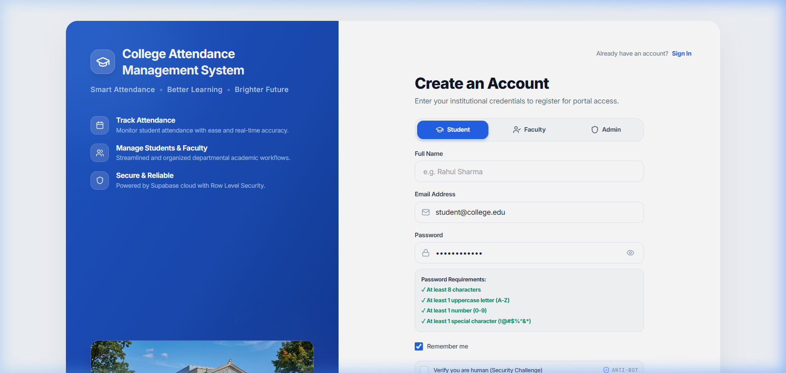
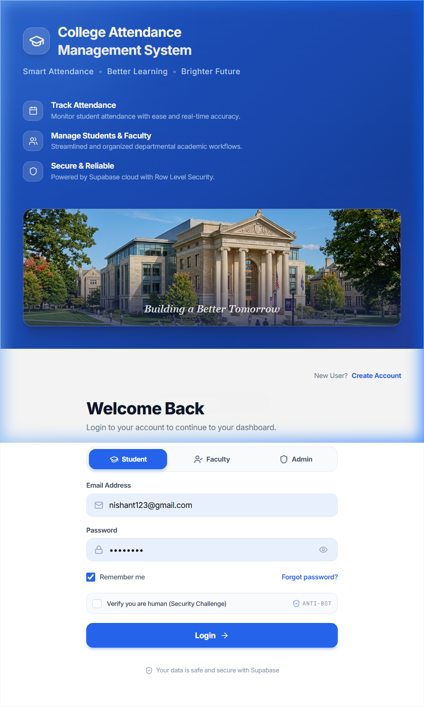
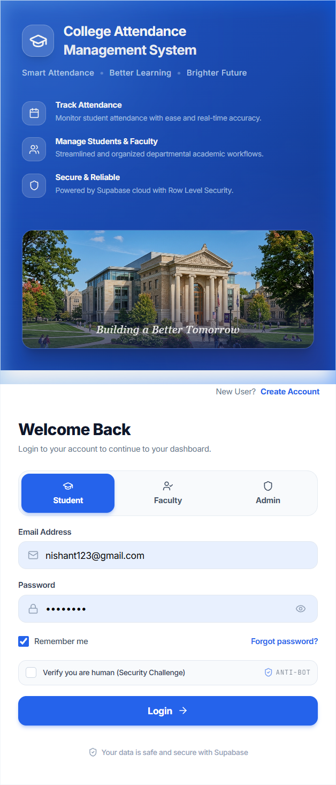

# College Attendance Management System (AttendOS)

**Current Version:** `1.5.1` | **Status:** 🟢 Production Ready & Tested | **CI/CD:** Passing (37/37 Tests)

An enterprise-grade, high-performance College Attendance Management & Academic Governance System built with **React 18**, **Vite 6**, **TanStack Query v5**, **TailwindCSS**, and **Supabase (PostgreSQL 15+, GoTrue Auth, Realtime & RLS)**. Designed specifically for Indian collegiate and university academic structures with full statutory compliance handling (AICTE/UGC 75% minimum threshold rules).

---

## 📸 Screenshots & Portal Previews

### 1. Modern Split-Screen Authentication Portal
The authentication gateway features an institutional branding panel with live feature highlights and campus building illustration alongside a clean, responsive credential form. On mobile devices, the login card is prioritized at the top for immediate access.

<p align="center">
  
</p>

### 2. Multi-Role Authentication Support
Strict Role-Based Access Control (**Student**, **Faculty**, and **College Administrator**) powered by Supabase Auth with sliding-window anti-brute-force rate limiting, 6-digit email OTP confirmation, and TOTP/MFA security challenges.

| Faculty Authentication Mode | Administrator Master Portal |
| :---: | :---: |
|  |  |

### 3. Student Registration & Academic Onboarding
Students can register with institutional email addresses, complete 6-digit OTP verification, and submit semester enrollment details (degree program, branch, semester, and university roll number) for administrative review.

<p align="center">
  
</p>

### 4. Full Device Responsiveness (Mobile & Tablet)
Fluidly optimized for all viewports—from 320px mobile phones to ultrawide 4K monitors:

| Tablet Viewport (768px × 1024px) | Mobile Viewport (375px × 667px) |
| :---: | :---: |
|  |  |

---

## 🌟 Key Features

### 👨‍🎓 1. Student Portal
- **Cumulative Attendance Tracking:** Real-time aggregate percentage calculation against the 75% statutory exam eligibility threshold.
- **Dynamic Check-in & Self-Punch:** Anti-proxy rotating QR code scanning and 4-digit live classroom OTP entry.
- **Weekly Timetable Schedule:** Day-by-day lecture periods, hall numbers, and assigned faculty details.
- **Leave Application Engine:** Online medical and on-duty (OD) leave applications with document attachment and status auditing.
- **Attendance Disputes:** Formal grievance submission for biometric/scanner discrepancies.
- **Digital Student ID:** Apple Wallet-style digital student identity card.

### 👩‍🏫 2. Faculty & Teacher Suite
- **Classroom Roster & Roll Call:** Real-time batch attendance marking with quick present/absent toggles and atomic database transactions.
- **Dynamic Projector Mode:** Full-screen classroom projector display broadcasting a 30-second rotating QR code, dynamic OTP, and authenticated faculty credentials.
- **Shortage & Deficit Alerts:** Automated identification of students with attendance < 75%, calculation of required recovery lectures, and direct WhatsApp advisory dispatch to parents.
- **Leave Approvals & Redressal:** One-click review, approval, or rejection of student medical leaves and attendance dispute audits.
- **Compliance Reporting:** Instant CSV and JSON export of batch attendance records and exam debarment circulars.

### 🏛️ 3. Master Administration Suite
- **Institutional User Directory:** Complete user directory with role assignment (Student, Faculty, Admin) and account status governance.
- **Registration Approvals:** Departmental review workflow for newly registered students before portal activation.
- **Academic Setup & Curriculum:** Configure Indian university degrees (B.Tech, BCA, MCA, BBA, MBA, B.Sc), academic blocks, semesters, courses, and faculty allocations.
- **Bulk Data Importer:** High-speed CSV/Excel parser to enroll entire cohorts and seed attendance databases.
- **Statutory Debarment Circular Generator:** Formal university notification generator formatted to AICTE and university ordinance standards for notice boards.

---

## 🛠️ Technology Stack

| Layer | Technologies |
| :--- | :--- |
| **Frontend Framework** | React 18, React Router v7 |
| **State & Cache** | TanStack Query v5 (`QueryClientProvider`, 5-min SWR background caching), React Context API |
| **Styling & UI** | TailwindCSS, Vanilla CSS, Apple Human Interface Design principles |
| **Icons & Visuals** | Lucide React, Canvas Confetti |
| **Backend & Cloud Database** | Supabase (PostgreSQL 15+, Row Level Security, Supabase Auth GoTrue, Realtime) |
| **AI Assistant** | Google Gemini 2.5 Flash / 3.8 Flash SDK Integration with graceful fallback |
| **Build & Tooling** | Vite 6, Vitest (Automated Unit & E2E Testing) |

---

## 🔒 Security & Access Control

- **Role Integrity Triggers:** PostgreSQL `BEFORE UPDATE` trigger `enforce_profile_role_integrity` prevents non-administrators from self-promoting account roles or altering approval statuses.
- **Row Level Security (RLS):** Granular policies across all 11 tables in the `public` schema. Anonymous data scraping is strictly restricted.
- **Atomic Transactions:** Stored procedure `public.commit_attendance_batch()` commits full class rosters in a single transactional boundary (`BEGIN ... COMMIT`), preventing race conditions.
- **Dynamic Identity Resolution:** The authenticated user's real profile name and credentials are dynamically reflected across frontend views, modals, and backend database session tables.
- **Production Hardened:** Developer bypasses and mock passwords have been completely removed; all operations require authentic Supabase credentials.

---

## 🚀 Getting Started

### Prerequisites
- Node.js (v18.0 or higher)
- npm or bun
- A Supabase project

### 1. Clone the repository

```bash
git clone https://github.com/Rahul2004/college_attedence_system.git
cd college_attedence_system
```

### 2. Install dependencies

```bash
npm install
```

### 3. Setup Environment Variables

Create a `.env` file in `college_attedence_system/`:

```env
VITE_SUPABASE_URL=https://your-project.supabase.co
VITE_SUPABASE_ANON_KEY=your-publishable-key-here
VITE_ADMIN_EMAIL=admin@college.edu.in
VITE_FACULTY_PASSKEY=FACULTY@2026
VITE_GEMINI_API_KEY=your-gemini-api-key
```

### 4. Database Setup & Migrations

Execute the following SQL migration scripts in sequential order inside your Supabase **SQL Editor**:

1. `database-schema.sql` — Core `profiles` table, constraints, and baseline RLS policies.
2. `supabase_system_settings.sql` — System governance parameters, threshold (75%), and Realtime publication.
3. `supabase_student_workflow_migration.sql` — Student onboarding state machine and approval workflows.
4. `supabase_security_hardening.sql` — Role integrity trigger (`enforce_profile_role_integrity`) and RLS hardening.
5. `supabase_phase2_normalization.sql` — Relational tables (`attendance_sessions`, `attendance_records`, `leave_applications`, `attendance_disputes`) and atomic stored procedure `commit_attendance_batch()`.

### 5. Run the Local Development Server

```bash
npm run dev
```

The portal will be live at `http://localhost:5173`.

---

## 🧪 Testing & Quality Assurance

AttendOS includes a comprehensive automated test suite powered by **Vitest**:

```bash
# Run all unit, security, subject-isolation and multi-role E2E tests
npm test

# Run tests in watch mode
npx vitest

# Run production build check
npm run build
```

### Test Coverage Highlights:
- **`attendance.test.js`** (9 tests): Statutory 75% threshold, bunk recovery math, and defaulter identification.
- **`security.test.js`** (6 tests): Database role integrity, rate limiting, and 403 access control.
- **`multi_role_e2e.test.js`** (12 tests): Multi-persona workflows, session isolation, and token refresh.
- **`subject_isolation.test.js`** (10 tests): Strict cross-subject data isolation and roster state protection.

---

## 📱 Supported Viewports

- **Mobile Viewports**: 320px, 360px, 375px, 390px, 430px
- **Tablets**: 480px, 768px, 1024px
- **Laptops & Desktops**: 1280px, 1440px, 1920px+ (Full HD & 4K Ultrawide)

---

## 📄 License

This project is licensed under the MIT License.
