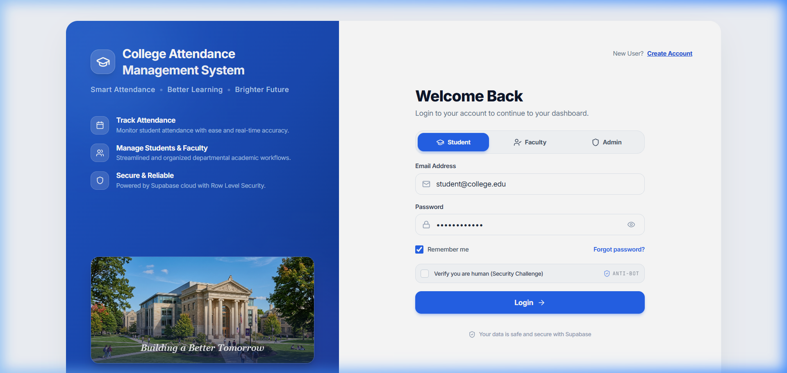
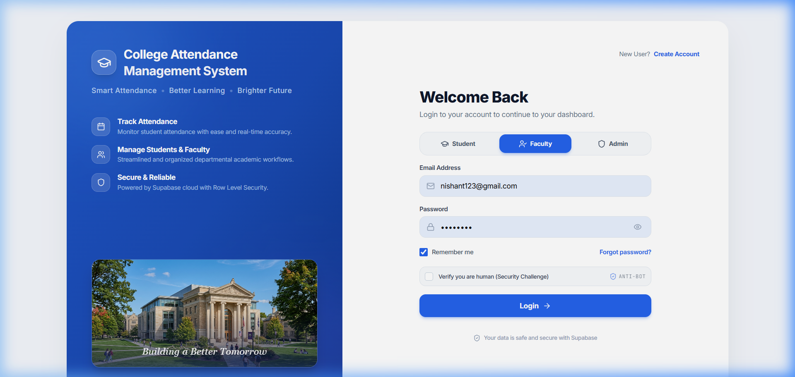
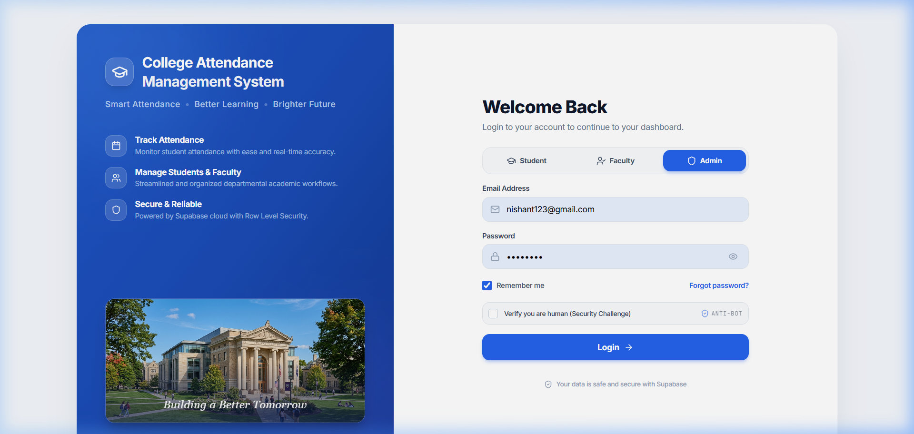
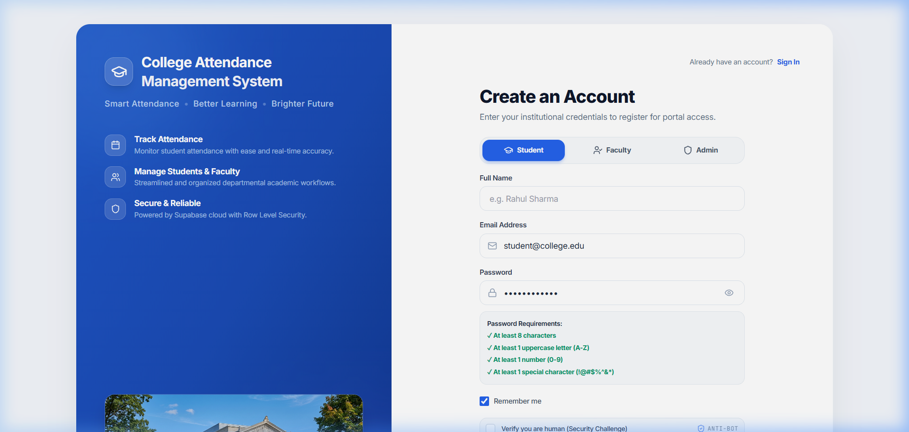
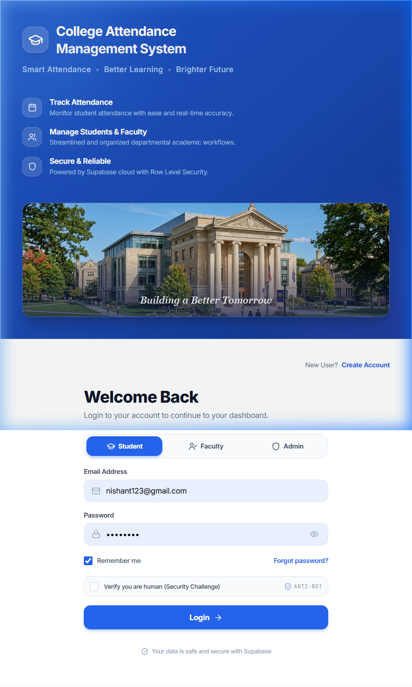
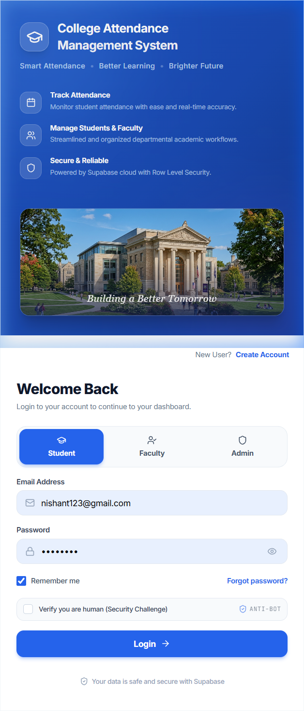

# College Attendance Management System (AttendOS)

A modern, enterprise-grade, responsive College Attendance Management System built with **React**, **Vite**, **TailwindCSS**, and **Supabase (PostgreSQL & Auth)**. Designed specifically for Indian collegiate and university academic structures with full statutory compliance handling.

---

## 📸 Screenshots & Portal Previews

### 1. Modern Split-Screen Authentication Portal
The login screen features an institutional blue branding panel on the left (with live feature highlights and the campus building illustration) and a clean, responsive authentication card on the right. On mobile devices, the login card is prioritized at the top for immediate access.

<p align="center">
  
</p>

### 2. Multi-Role Authentication Support
Seamless 1-click switching between **Student**, **Faculty**, and **Administrator** access tiers with automatic input resolution, rate-limiting, and TOTP/MFA security.

| Faculty Authentication Mode | Administrator Master Portal |
| :---: | :---: |
|  |  |

### 3. Student Registration & Academic Onboarding
Students can register with official institutional emails, verify their address via OTP confirmation, and complete their semester enrollment details (degree program, branch, and university roll number).

<p align="center">
  
</p>

### 4. Full Device Responsiveness (Mobile & Tablet)
Fluidly optimized for all viewports—from 320px mobile phones to ultrawide 4K monitors:

| Tablet Viewport (768px × 1024px) | Mobile Viewport (375px × 667px) |
| :---: | :---: |
|  |  |

---

## 🌟 Key Features

### 👨‍🎓 1. Student Portal
- **Cumulative Attendance Tracking**: Real-time aggregate percentage calculation against the 75% statutory exam eligibility threshold.
- **Dynamic Check-in & Self-Punch**: Anti-proxy rotating QR code scanning and 4-digit classroom OTP entry.
- **Weekly Timetable Schedule**: Day-by-day lecture periods, hall numbers, and assigned faculty details.
- **Leave Application Engine**: Online medical and on-duty (OD) leave applications with document attachment and AI assistance.
- **Attendance Disputes**: Formal dispute submission for bio-metric/scanner discrepancies.
- **Admit Card & Hall Ticket**: Automated verification seal and hall ticket clearance generation based on attendance compliance.

### 👩‍🏫 2. Faculty & Teacher Suite
- **Classroom Roster & Roll Call**: Real-time batch attendance marking with quick present/absent toggles and instant database synchronization.
- **Dynamic Projector Mode**: Full-screen classroom projector display broadcasting a rotating 30-second dynamic QR code and OTP.
- **Shortage & Deficit Alerts**: Automated identification of students with attendance < 75%, calculation of required recovery lectures, and direct WhatsApp advisory dispatch to parents.
- **Leave Approvals & Redressal**: One-click review, approval, or rejection of student medical leaves and attendance dispute audits.
- **Compliance Reporting**: Instant CSV and PDF export of batch attendance records and exam debarment circulars.

### 🏛️ 3. Master Administration Suite
- **Institutional User Directory**: Complete user directory with role assignment (Student, Faculty, Admin) and account status governance.
- **Registration Approvals**: Departmental review workflow for newly registered students before portal activation.
- **Academic Setup & Curriculum**: Configure Indian university degrees (B.Tech, BCA, MCA, BBA, MBA, B.Sc), academic blocks, semesters, courses, and faculty allocations.
- **Bulk Data Importer**: High-speed CSV/Excel parser to enroll entire cohorts and seed attendance databases.
- **Statutory Debarment Circular Generator**: Formal university notification generator formatted to AICTE and university ordinance standards for notice boards.

---

## 🛠️ Technology Stack

- **Frontend Core**: React 18, React Router v7
- **Styling & Design System**: TailwindCSS, Vanilla CSS, Apple Human Interface Design principles
- **Icons & Visuals**: Lucide React, Canvas Confetti
- **Backend & Cloud Database**: Supabase (PostgreSQL with Row Level Security, Supabase Auth, Realtime)
- **Build Tool**: Vite 6

---

## 🚀 Getting Started

### Prerequisites
- Node.js (v18.0 or higher)
- npm or bun
- A Supabase project

### 1. Clone the repository

```bash
git clone https://github.com/Rahul2004/college_attedence_system.git
cd college_attedence_system
```

### 2. Install dependencies

```bash
npm install
```

### 3. Setup Environment Variables

Create a `.env` file in the root directory:

```env
VITE_SUPABASE_URL=https://your-project.supabase.co
VITE_SUPABASE_ANON_KEY=your-anon-key-here
VITE_ADMIN_EMAIL=admin@college.edu.in
VITE_ADMIN_PASSWORD=your_secure_password
VITE_FACULTY_PASSKEY=FACULTY@2026
```

### 4. Database Setup

Run the SQL migration files in your Supabase SQL Editor:
1. `database-schema.sql` — Core tables, constraints, and Row Level Security policies.
2. `supabase_system_settings.sql` — System governance parameters and thresholds.
3. `supabase_student_workflow_migration.sql` — Student onboarding and approval states.

### 5. Run the Local Development Server

```bash
npm run dev
```

The portal will be live at `http://localhost:5173`.

---

## 📱 Supported Viewports

- **Small Mobile Devices**: 320px, 360px, 375px, 390px, 430px
- **Large Mobile & Tablets**: 480px, 768px, 1024px
- **Laptops & Desktops**: 1280px, 1440px, 1920px+ (Full HD & 4K Ultrawide)

---

## 📄 License

This project is licensed under the MIT License.
